<p align="center">
  
</p>

<p align="center"><a href="README.md">Deutsch</a> · <b>English</b></p>

<p align="center"><b>Evolve. Adapt. Strike.</b><br>
A horizontal pixel-art shoot ’em up starring a bee – a homage to <i>Apidya</i> (Amiga, 1992).</p>

<p align="center">
  <a href="https://ko-fi.com/floppi77"></a>
</p>

<p align="center">
  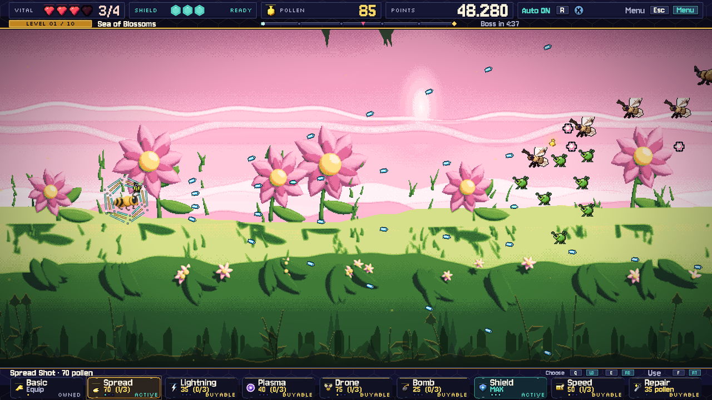
</p>

Yuri, a battle bee, flies through ten realms – from the sunny Sea of Blossoms through root caves,
the Fungal Forest and the storm into the biomechanical Hive and the Core of Transformation.

Weapons, workshop upgrades and evolutions combine into very different builds: wave shots in orbit,
chain lightning with a splinter core, or a shield as a honeycomb shell. Every level ends with a
boss that moves like its animal and escalates over several phases.

## Gallery

| | |
|---|---|
| 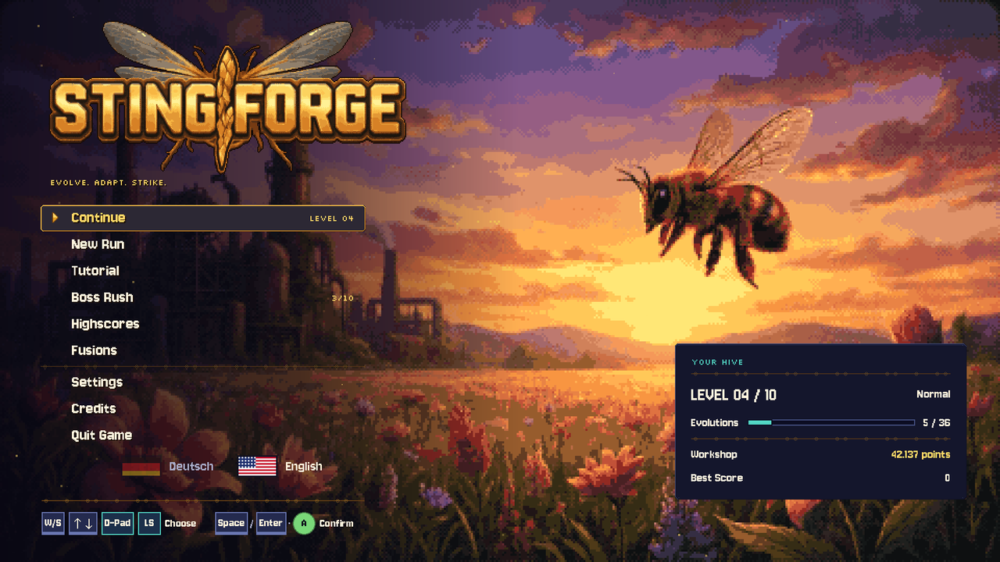 | 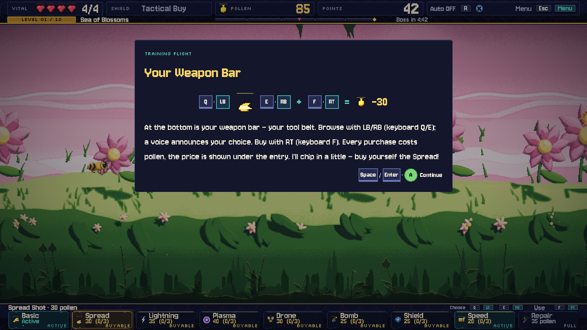 |
| **Main menu** – your progress at a glance, language switch by flag | **Tutorial** – the game pauses and explains with pictures |
| 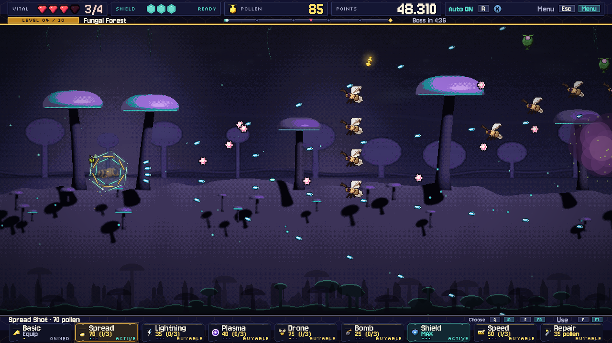 | 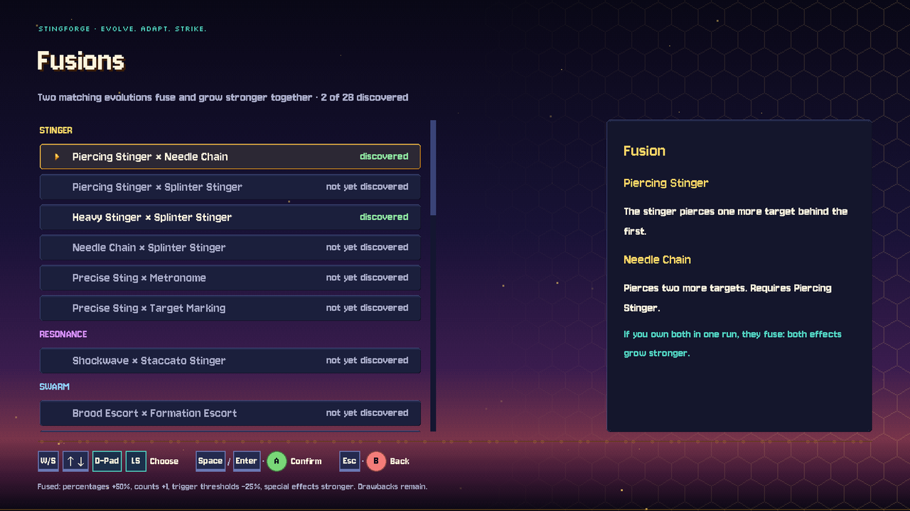 |
| **Fungal Forest** – drifting spore clouds narrow the paths | **Fusions** – discovered pairs, the rest waits greyed out |
| 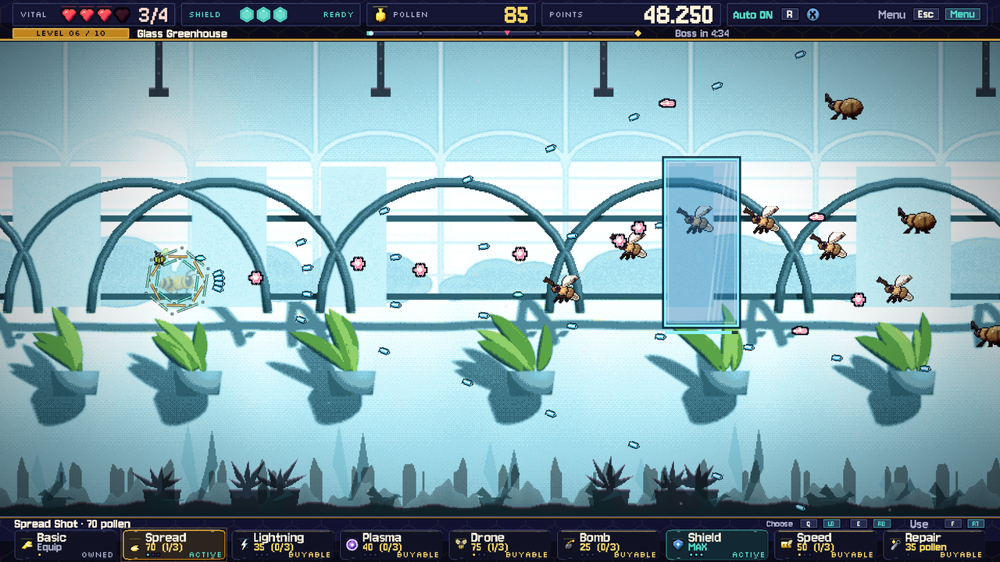 | 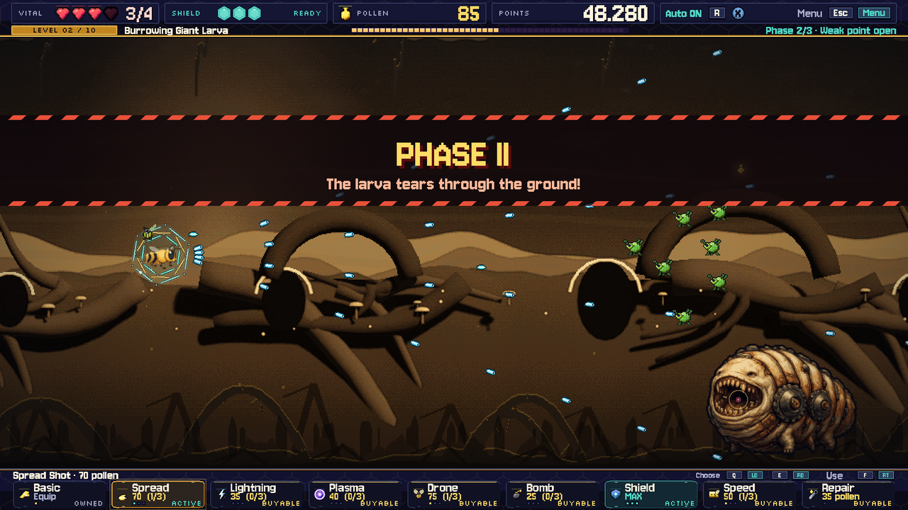 |
| **Glass Greenhouse** – glass panes block shots until they shatter | **Burrowing Giant Larva** – phase changes with a grand entrance |
| 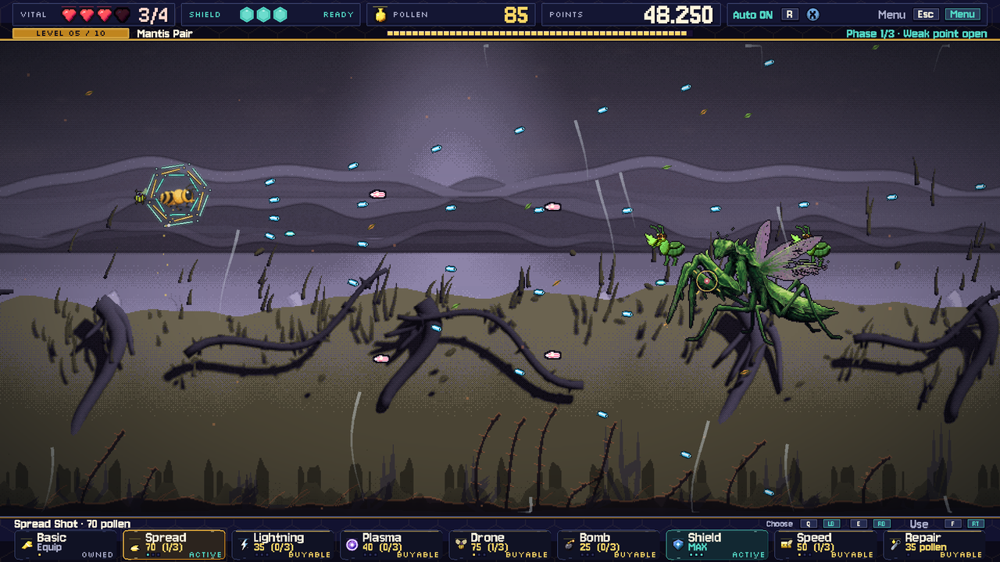 | 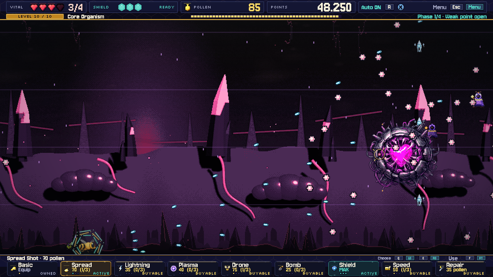 |
| **Mantis Pair** – two blades, one rhythm | **Core of Transformation** – the final boss (and not for the last time) |
| 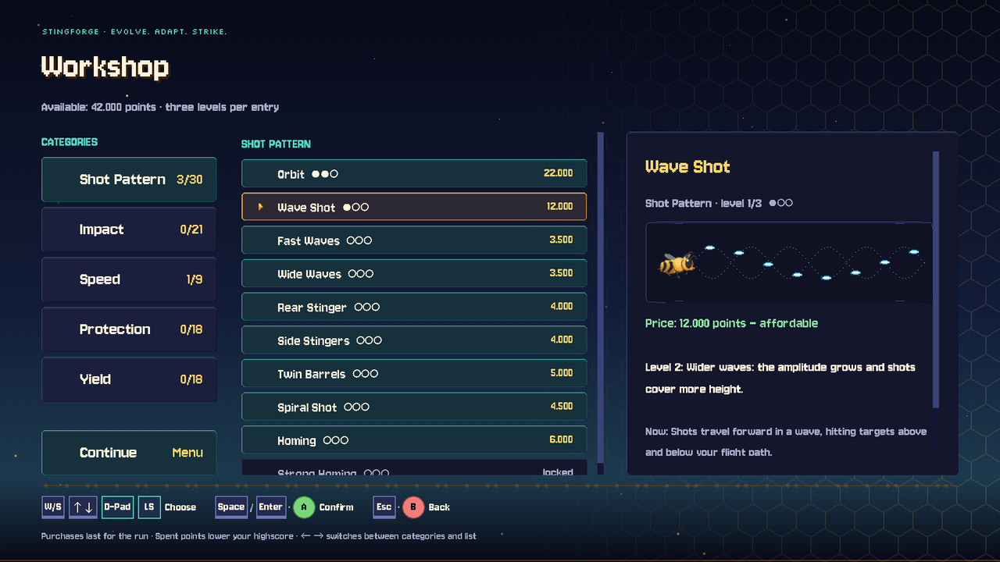 | 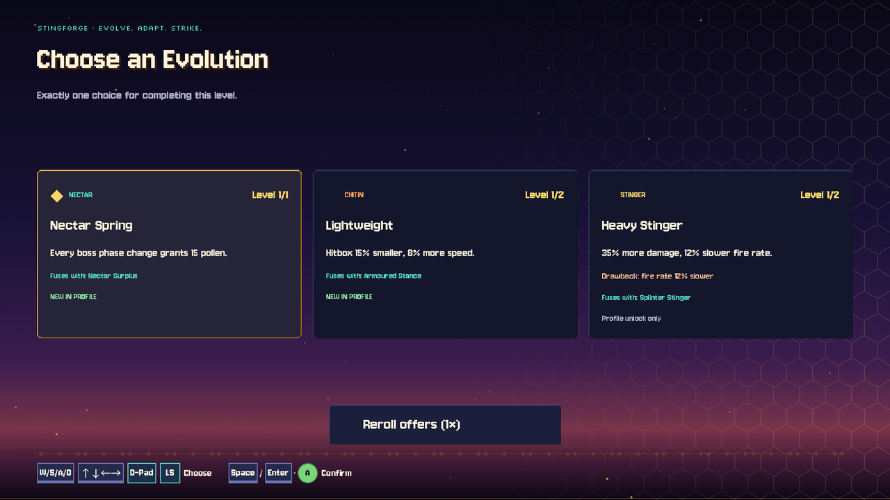 |
| **Workshop** – categories, upgrades, animated explanation | **Evolution** – a permanent development after every level |

**Ultrawide:** the playfield stays 16:9, the sides continue the level scenery.

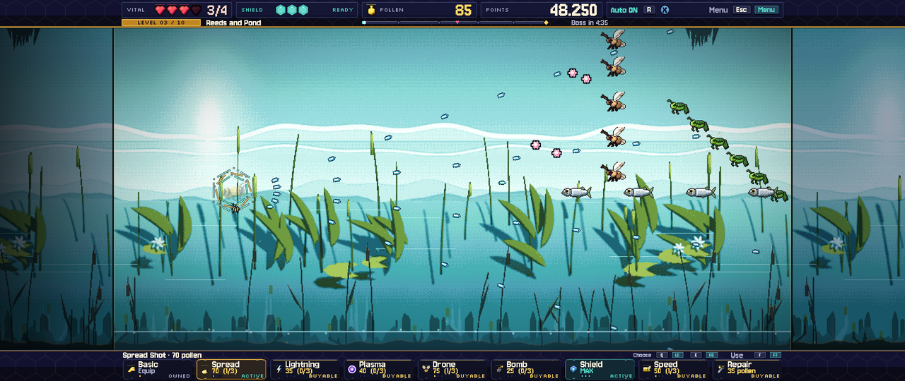
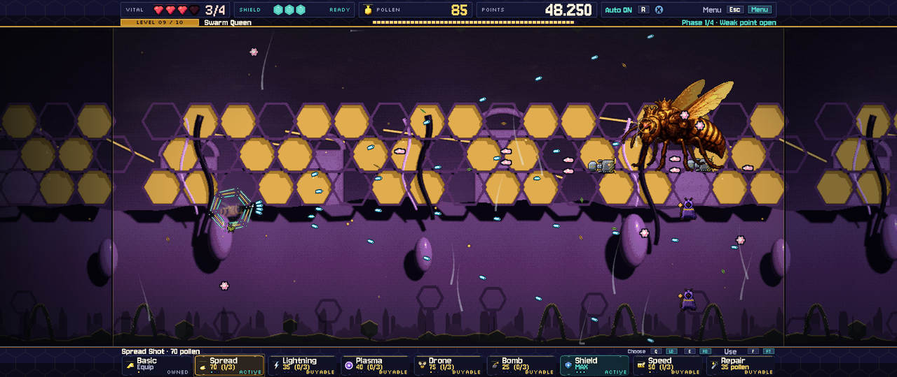

## Features

- **Tutorial:** a short training flight in the first world explains controls, pollen, the weapon
  bar, the workshop and the highscore. The game pauses each time and shows a picture window.
- **Ten levels, ten bosses:** every boss with its own movement and attacks. Phase changes come with
  a grand entrance, and what is announced actually happens.
- **Tactical weapon bar:**
  - Basic, Spread, Lightning and Plasma weapons, Drone, Bombs, Shield and Speed, bought with pollen.
  - A voice announces the selected upgrade while you browse.
- **Workshop:** 32 permanent upgrades in five categories, bought with points, each with an
  animated explanation. Only available between levels. Points you spend lower your highscore.
- **Evolutions and starting talents:**
  - 20 starting talents, three of them offered at random; one evolution after every level.
  - Matching evolutions **fuse** and grow stronger together.
  - The main menu collects every fusion you discover.
- **Original soundtrack:**
  - Every level has a fully composed track, exactly as long as the way to the boss and in sync
    with the level time.
  - The boss music starts seamlessly at the same tempo and loops for as long as the fight lasts.
- **Platforms:** Linux, Windows and macOS.
- **Bilingual:** German and English, including voice announcements; switch by flag in the main menu.
- **Three difficulty levels** that really differ: projectile density and speed, boss tempo, hit
  damage, shield recharge, enemy count and grace period.
- **Pixel look at 1920 × 1080:** ultrawide (21:9, 32:9) and 16:10, pixel fonts, Amiga-style menus.
- **Modes:**
  - Run with checkpoints
  - Boss Rush with the bosses you have already beaten in the current run
  - Highscores with name entry
- **Controls:** keyboard, mouse and Xbox controller, fully rebindable, both device types always
  shown together.

## Play

Ready-to-play files for **Windows** and **Linux** are built as a single file without installation,
for **macOS** (Intel and Apple Silicon) as a ZIP containing the app. They are too large for the
repository and are published under [Releases](https://github.com/floppi77/stingforge/releases).

The Mac app is not notarised by Apple: on first launch, right-click it in the Finder and choose
“Open”. Every release contains `SHA256SUMS.txt`; how to verify downloads is described in
[SECURITY.md](SECURITY.md).

| Action | Keyboard | Controller |
|---|---|---|
| Fly | WASD / arrows | left stick |
| Fire (hold) | Space | A |
| Browse weapon bar | Q / E | LB / RB |
| Buy / activate | F | RT |
| Pause | Esc | Start |

Everything else is in the [manual](docs/MANUAL.md).

## Building from source

Requires **Godot 4.7** (GL Compatibility).

```bash
export XDG_DATA_HOME="$PWD/.godot_data" XDG_CONFIG_HOME="$PWD/.godot_config" XDG_CACHE_HOME="$PWD/.godot_cache"
godot --headless --path . --export-release Linux build/linux/Stingforge.x86_64
godot --headless --path . --export-release Windows build/windows/Stingforge.exe
godot --headless --path . --export-release macOS build/macos/Stingforge-macOS.zip
python3 tools/verify_stingforge_r3.py     # 43 regression suites
```

Details (German): [build guide](docs/BUILD.md).

**Releases** are built by CI ([release.yml](.github/workflows/release.yml)): a `v*` tag produces the
files for all three platforms, checksums and a draft GitHub release. Security checks run on every
push, see [SECURITY.md](SECURITY.md).

```bash
git tag v0.5.0 && git push origin v0.5.0
```

## Soundtrack pipeline

The music is written as code in [tools/music](tools/music/):

1. **Composition:** scores in Python with a tempo map that puts every checkpoint on a bar start.
2. **Instruments:** sfizz plays the free sample libraries, Csound provides the synthesizers.
3. **Mixing and mastering:** −16 LUFS, −1 dBTP.
4. **Measurement report:** one report with a spectrogram per track.

Concept and tools (German): [soundtrack concept](docs/SOUNDTRACK_KONZEPT.md).
The sample libraries are not included but downloaded when needed.

## Project layout

- **Game world:** [scripts/game](scripts/game/)
- **Menus and HUD:** [scripts/screens](scripts/screens/)
- **UI building blocks:** [scripts/core](scripts/core/)
- **Graphics, fonts, music, sounds and translations:** [assets](assets/) (English texts in
  [assets/i18n/en.json](assets/i18n/en.json))
- **Automated checks:** [tests](tests/)
- **Tools** (pixel pipeline, music, voice, verification and packaging scripts): [tools](tools/)

## Credits and third-party licences

- **Fonts:** Jersey 10, Silkscreen, Pixelify Sans, Nunito and Oxanium, all under the
  [SIL Open Font License](assets/ui/fonts/pixel/OFL-Jersey10.txt).
- **Samples:** [VSCO 2 Community Edition](https://github.com/sgossner/VSCO-2-CE) and
  [Versilian Community Sample Library](https://github.com/sgossner/VCSL) by Versilian Studios
  (CC0), for the soundtrack.
- **Voice announcements:** generated locally with [Qwen3-TTS](https://github.com/QwenLM/Qwen3-TTS)
  (VoiceDesign and Base models, Apache-2.0). The voice was designed from a description and does
  not belong to a real speaker.
- Made with Vibe, DeepSeek, Sol, Opus, Coffee, Qwen and Love.
- **Inspiration:** *Apidya* (Kaiko, 1992). Stingforge is an independent homage with no connection
  to the rights holders.

Full third-party notices, including the Godot Engine (MIT):
[THIRD_PARTY_NOTICES.md](THIRD_PARTY_NOTICES.md).

## Support

Stingforge is free. If you enjoy the game, I'd be happy about a coffee on
[Ko-fi](https://ko-fi.com/floppi77).

## Licence

Stingforge is free for all **non-commercial** purposes: play it, share it, modify it, learn from
it, make your own fan projects. Commercial use is reserved to the author.

- **Code:** [PolyForm Noncommercial 1.0.0](LICENSE)
- **Content** (graphics, music, voice, levels, texts):
  [CC BY-NC-SA 4.0](LICENSE-ASSETS.md) – with attribution and share-alike
- The name and logo “Stingforge” are excluded from these licences.

© 2026 floppi77
