<p align="center">
  
</p>

<p align="center"><a href="#deutsch">Deutsch</a> · <a href="#english">English</a></p>

<p align="center"><b>Evolve. Adapt. Strike.</b><br>
Ein horizontales Pixel-Shoot’em-up mit einer Biene in der Hauptrolle – eine Hommage an <i>Apidya</i> (Amiga, 1992).<br>
A horizontal pixel-art shoot ’em up starring a bee – a homage to <i>Apidya</i> (Amiga, 1992).</p>

<p align="center">
  <a href="https://github.com/floppi77/stingforge/actions/workflows/regression.yml"></a>
  <a href="https://github.com/floppi77/stingforge/actions/workflows/security.yml"></a>
  <a href="https://scorecard.dev/viewer/?uri=github.com/floppi77/stingforge"></a>
  <a href="https://ko-fi.com/floppi77"></a>
</p>

<p align="center">
  <a href="https://github.com/floppi77/stingforge/releases/latest"><b>⬇ Download (Windows · Linux · macOS)</b></a>
</p>

# Deutsch

<p align="center">
  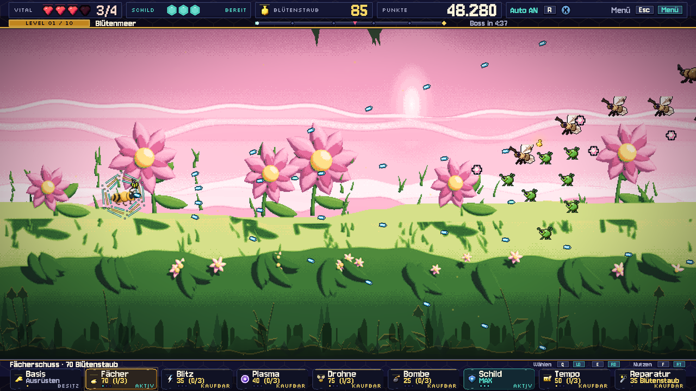
</p>

Yuri, eine Kampfbiene, fliegt durch zehn Reiche – vom sonnigen Blütenmeer über Wurzelhöhlen,
Pilzwald und Sturm bis in den biomechanischen Schwarmstock und den Kern der Verwandlung.

Waffen, Werkstatt-Upgrades und Evolutionen lassen sich zu ganz unterschiedlichen Builds kombinieren:
Wellenschuss im Kreisflug, Kettenblitz mit Splitterkern oder ein Schild als Wabenhülle.
Jedes Level endet mit einem Boss, der sich wie sein Tier bewegt und in mehreren Phasen eskaliert.

## Galerie

| | |
|---|---|
| 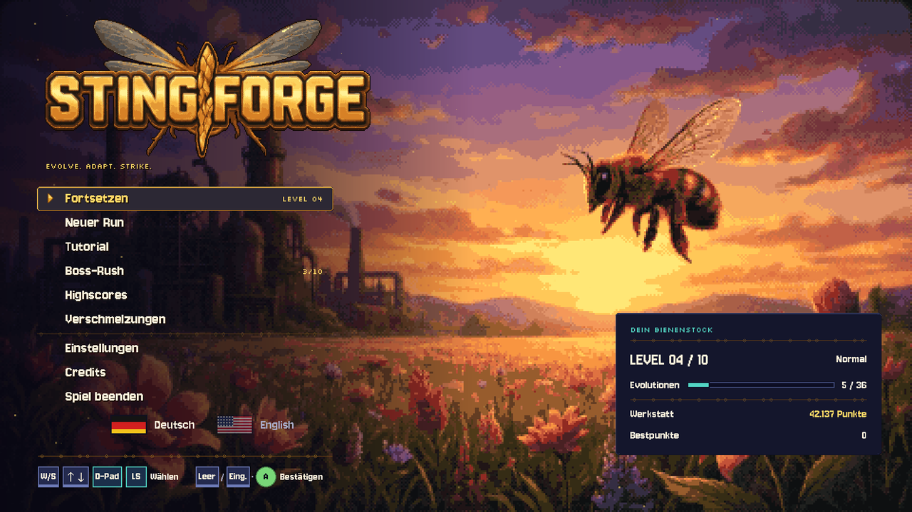 | 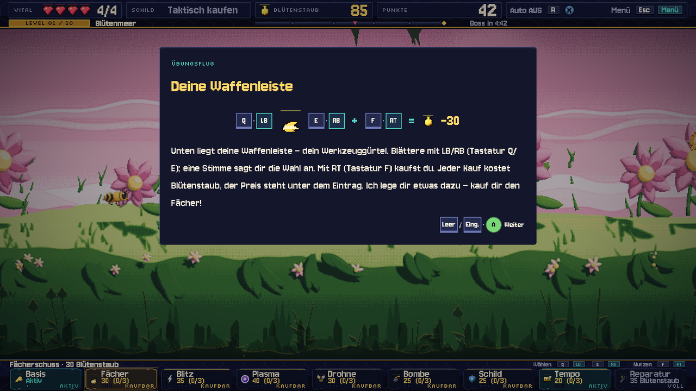 |
| **Hauptmenü** – Spielstand auf einen Blick, Sprachwahl per Flagge | **Tutorial** – das Spiel hält an und erklärt in Bildern |
| 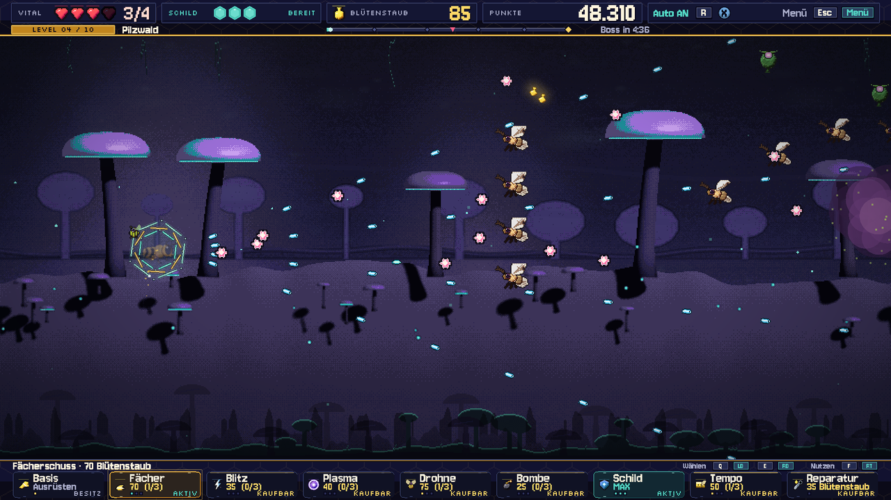 | 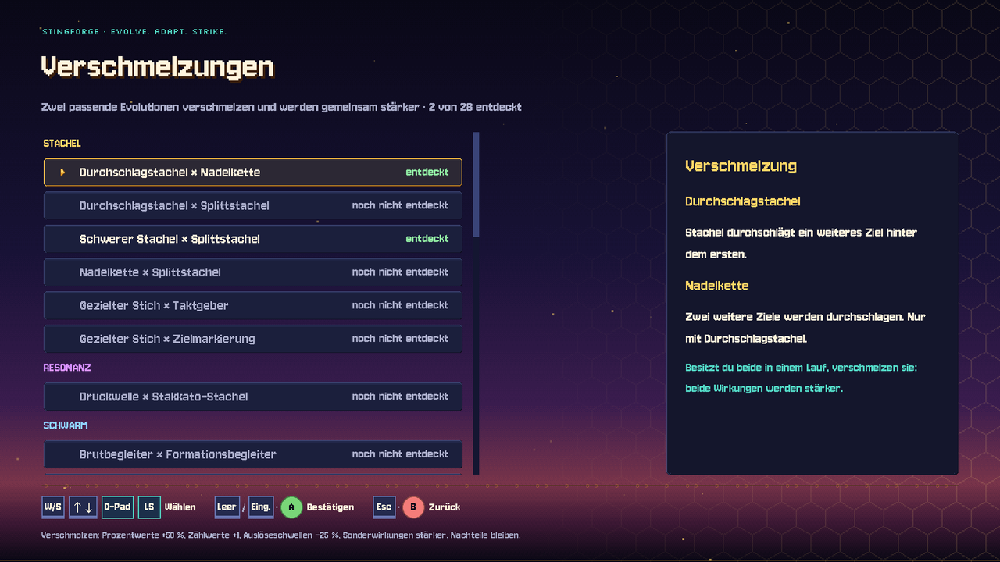 |
| **Pilzwald** – wandernde Sporenwolken engen die Wege ein | **Verschmelzungen** – Meister (gold) und Verschmelzungen (türkis) mit Hilfsgrafik |
| 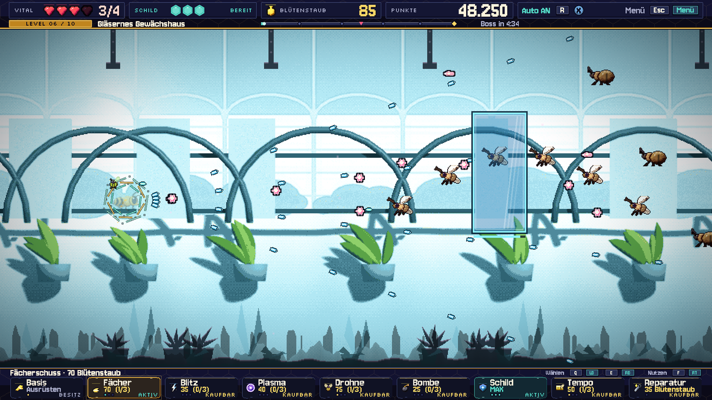 | 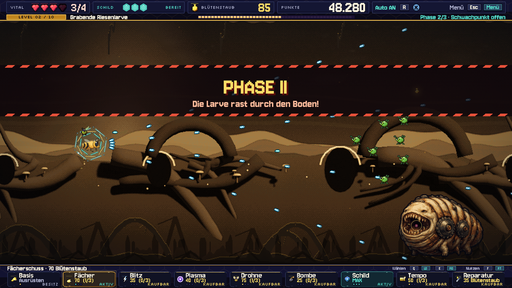 |
| **Gläsernes Gewächshaus** – Glasscheiben fangen Schüsse ab, bis sie zerspringen | **Grabende Riesenlarve** – Phasenwechsel mit Auftritt |
| 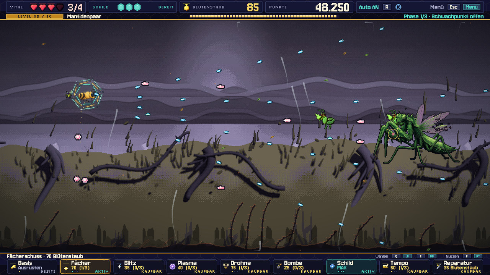 | 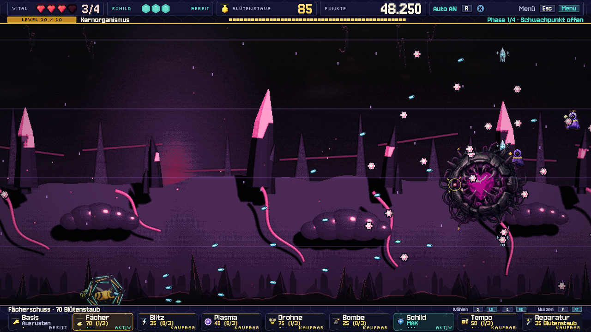 |
| **Mantidenpaar** – zwei Klingen, ein Rhythmus | **Kern der Verwandlung** – der Endboss (und nicht zum letzten Mal) |
| 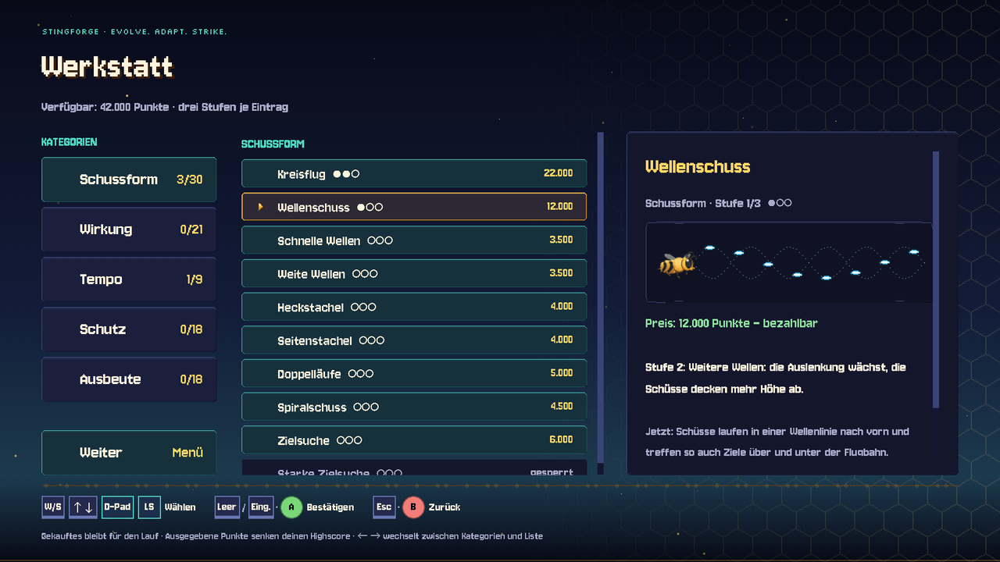 | 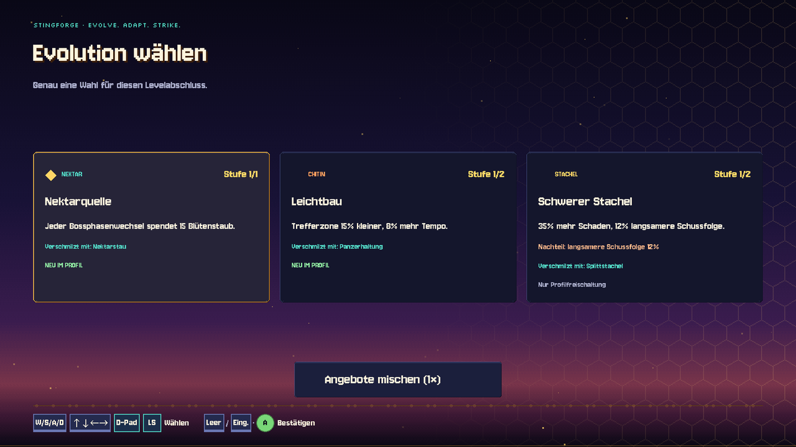 |
| **Werkstatt** – Kategorien, Upgrades, animierte Erklärszene | **Evolution** – Hilfsgrafik und Rezepte: grün vorhanden, grau fehlend |

**Ultrawide:** Das Spielfeld bleibt 16:9, die Seiten zeigen die Levelkulisse weiter.


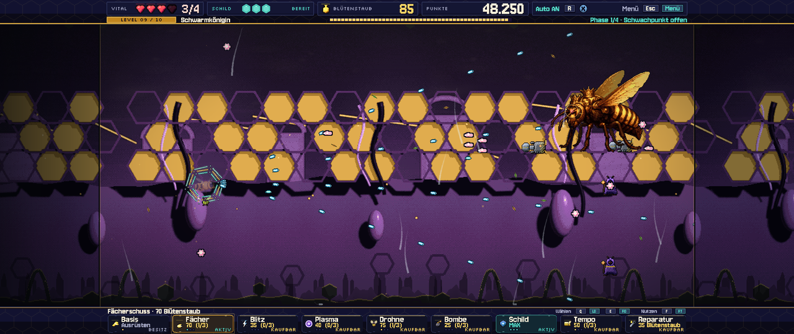

## Was drinsteckt

- **Tutorial:** ein kurzer Übungsflug in der ersten Welt erklärt Steuerung, Blütenstaub,
  Waffenleiste, Werkstatt und Highscore. Das Spiel hält dafür jeweils an und blendet ein Bildfenster ein.
- **Zehn Level, zehn Bosse:** jeder Boss mit eigenen Bewegungen und Angriffen. Phasenwechsel
  kommen mit Auftritt, und was angesagt wird, passiert auch. Nach dem Endboss fliegt die Biene
  im Abspann-Level durch die wieder befriedete Welt.
- **Taktische Waffenleiste:**
  - Basis-, Fächer-, Blitz- und Plasmawaffe, Drohne, Bomben, Schild und Tempo, gekauft mit Nektar.
  - Beim Blättern sagt eine Stimme das gewählte Upgrade an.
- **Werkstatt:** 32 dauerhafte Upgrades in fünf Kategorien, mit Punkten gekauft, jedes mit einer
  animierten Erklärszene. Sie ist nur zwischen den Leveln erreichbar. Ausgegebene Punkte senken
  den Highscore.
- **Evolutionen und Starttalente:**
  - 20 Starttalente, drei davon zufällig zur Wahl; nach jedem Level eine Evolution.
  - **Zwölf Meisterevolutionen:** Aus zwei passenden Evolutionen entsteht eine neue Fähigkeit,
    etwa ein Pollensturm um die Biene, ein Schildwall aus Drohnen oder Gewitter aus Resonanzschüssen.
  - Weitere Paare **verschmelzen** und werden gemeinsam stärker; das Sammelbuch im Hauptmenü
    zeigt alle Rezepte.
- **Eigener Soundtrack:**
  - Jedes Level hat einen durchkomponierten Track, exakt so lang wie der Weg bis zum Boss und
    synchron zur Levelzeit.
  - Die Bossmusik setzt nahtlos im selben Tempo ein und loopt, solange der Kampf dauert.
- **Plattformen:** Linux, Windows und macOS.
- **Zweisprachig:** Deutsch und Englisch, inklusive Sprachansagen; umschaltbar per Flagge im
  Hauptmenü.
- **Drei Schwierigkeitsgrade,** die sich deutlich unterscheiden: Geschossdichte und -tempo,
  Takt der Bosse, Trefferschaden, Schildladezeit, Gegnerzahl und Gnadenzeit.
- **Pixellook in 1920 × 1080:** Ultrawide (21:9, 32:9) und 16:10, Pixelschriften, Menüs im Amiga-Stil.
- **Modi:**
  - Run mit Checkpoints
  - Boss-Rush mit den Bossen, die im laufenden Run schon besiegt sind
  - Highscores mit Namenseingabe
- **Bedienung:** Tastatur, Maus und Xbox-Controller, frei belegbar, beide Gerätearten
  immer gleichzeitig angezeigt.

## Spielen

Fertige Spieldateien für **Windows** und **Linux** werden als einzelne Datei ohne Installation
gebaut, für **macOS** (Intel und Apple Silicon) als ZIP mit der App. Sie sind zu groß für das
Repository und gehören zu den [Releases](https://github.com/floppi77/stingforge/releases).

Die Mac-App ist nicht von Apple notarisiert: beim ersten Start im Finder Rechtsklick ›
„Öffnen“ wählen. Jedes Release enthält `SHA256SUMS.txt`; wie man Downloads prüft, steht in
[SECURITY.md](SECURITY.md).

| Aktion | Tastatur | Controller |
|---|---|---|
| Fliegen | WASD / Pfeile | linker Stick |
| Schießen (halten) | Leertaste | A |
| Waffenleiste wählen | Q / E | LB / RB |
| Kaufen / aktivieren | F | RT |
| Pause | Esc | Start |

Alles Weitere steht im [Handbuch](docs/HANDBUCH.md) ([English manual](docs/MANUAL.md)).

## Aus den Quellen bauen

Benötigt **Godot 4.7** (GL Compatibility).

```bash
export XDG_DATA_HOME="$PWD/.godot_data" XDG_CONFIG_HOME="$PWD/.godot_config" XDG_CACHE_HOME="$PWD/.godot_cache"
godot --headless --path . --export-release Linux build/linux/Stingforge.x86_64
godot --headless --path . --export-release Windows build/windows/Stingforge.exe
godot --headless --path . --export-release macOS build/macos/Stingforge-macOS.zip
python3 tools/verify_stingforge_r3.py     # 45 Regressionssuiten
```

Details: [Build-Anleitung](docs/BUILD.md).

**Releases** baut die CI ([release.yml](.github/workflows/release.yml)): Ein Tag `v*` erzeugt
die Dateien für alle drei Plattformen, Prüfsummen und einen Entwurf des GitHub-Releases.
Sicherheitsprüfungen laufen bei jedem Push, siehe [SECURITY.md](SECURITY.md).

Vor dem Tag die Versionsnummer in `export_presets.cfg` (`application/version` und
`application/short_version`) anheben und committen; die CI bricht ab, wenn Tag und Version
nicht zusammenpassen. Veröffentlichte Releases sind unveränderlich, Korrekturen bekommen
eine neue Version.

```bash
git tag vX.Y.Z && git push origin vX.Y.Z
```

## Soundtrack-Pipeline

Die Musik entsteht als Code in [tools/music](tools/music/):

1. **Komposition:** Partituren in Python mit einer Tempokarte, die jeden Checkpoint auf einen
   Taktanfang legt.
2. **Instrumente:** sfizz spielt die freien Sample-Bibliotheken ab, Csound liefert die
   Synthesizer.
3. **Mix und Mastering:** −16 LUFS, −1 dBTP.
4. **Messbericht:** je Track ein Bericht mit Spektrogramm.

Konzept und Werkzeuge: [Soundtrack-Konzept](docs/SOUNDTRACK_KONZEPT.md).
Die Sample-Bibliotheken werden nicht mitgeliefert, sondern bei Bedarf geladen.

## Projektaufbau

- **Spielwelt:** [scripts/game](scripts/game/)
- **Menüs und HUD:** [scripts/screens](scripts/screens/)
- **UI-Bausteine:** [scripts/core](scripts/core/)
- **Grafik, Schriften, Musik und Klänge:** [assets](assets/)
- **Automatisierte Prüfungen:** [tests](tests/)
- **Werkzeuge** (Pixel-Pipeline, Musik, Prüf- und Paketskripte): [tools](tools/)
- **Änderungsberichte:** [R4](docs/STINGFORGE_R4.md) · [R3](docs/STINGFORGE_R3.md) · [R2](docs/STINGFORGE_R2.md)

## Danksagung und Lizenzen Dritter

- **Schriften:** Jersey 10, Silkscreen, Pixelify Sans, Nunito und Oxanium, alle unter der
  [SIL Open Font License](assets/ui/fonts/pixel/OFL-Jersey10.txt).
- **Samples:** [VSCO 2 Community Edition](https://github.com/sgossner/VSCO-2-CE) und
  [Versilian Community Sample Library](https://github.com/sgossner/VCSL) von Versilian Studios
  (CC0), für den Soundtrack.
- **Sprachansagen:** erzeugt lokal mit [Qwen3-TTS](https://github.com/QwenLM/Qwen3-TTS)
  (Modelle VoiceDesign und Base, Apache-2.0). Die Stimme ist aus einer Beschreibung
  entworfen, sie gehört keinem echten Sprecher.
- Made with Vibe, DeepSeek, Sol, Opus, Coffee, Qwen and Love.
- **Vorbild:** *Apidya* (Kaiko, 1992). Stingforge ist eine eigenständige Hommage, ohne
  Verbindung zu den Rechteinhabern.

Vollständige Hinweise zu Fremdbestandteilen, auch zur Godot Engine (MIT):
[THIRD_PARTY_NOTICES.md](THIRD_PARTY_NOTICES.md).

## Unterstützen

Stingforge ist kostenlos. Wenn dir das Spiel gefällt, freue ich mich über einen Kaffee auf
[Ko-fi](https://ko-fi.com/floppi77).

## Lizenz

Stingforge ist frei für alle **nicht-kommerziellen** Zwecke: spielen, weitergeben,
verändern, lernen, eigene Fan-Projekte. Kommerzielle Nutzung ist dem Urheber vorbehalten.

- **Code:** [PolyForm Noncommercial 1.0.0](LICENSE)
- **Inhalte** (Grafik, Musik, Stimme, Level, Texte):
  [CC BY-NC-SA 4.0](LICENSE-ASSETS.md) – mit Namensnennung und Weitergabe unter gleichen Bedingungen
- Name und Logo „Stingforge“ sind von den Lizenzen ausgenommen.

© 2026 floppi77

---

# English

<p align="center">
  
</p>

Yuri, a battle bee, flies through ten realms – from the sunny Sea of Blossoms through root caves,
the Fungal Forest and the storm into the biomechanical Hive and the Core of Transformation.

Weapons, workshop upgrades and evolutions combine into very different builds: wave shots in orbit,
chain lightning with a splinter core, or a shield as a honeycomb shell. Every level ends with a
boss that moves like its animal and escalates over several phases.

## Gallery

| | |
|---|---|
|  |  |
| **Main menu** – your progress at a glance, language switch by flag | **Tutorial** – the game pauses and explains with pictures |
|  |  |
| **Fungal Forest** – drifting spore clouds narrow the paths | **Fusions** – masters (gold) and fusions (teal) with illustrations |
|  |  |
| **Glass Greenhouse** – glass panes block shots until they shatter | **Burrowing Giant Larva** – phase changes with a grand entrance |
|  |  |
| **Mantis Pair** – two blades, one rhythm | **Core of Transformation** – the final boss (and not for the last time) |
|  |  |
| **Workshop** – categories, upgrades, animated explanation | **Evolution** – illustration and recipes: green owned, grey missing |

**Ultrawide:** the playfield stays 16:9, the sides continue the level scenery.


## Features

- **Tutorial:** a short training flight in the first world explains controls, pollen, the weapon
  bar, the workshop and the highscore. The game pauses each time and shows a picture window.
- **Ten levels, ten bosses:** every boss with its own movement and attacks. Phase changes come with
  a grand entrance, and what is announced actually happens. After the final boss the bee flies
  through the pacified world in a credits level.
- **Tactical weapon bar:**
  - Basic, Spread, Lightning and Plasma weapons, Drone, Bombs, Shield and Speed, bought with pollen.
  - A voice announces the selected upgrade while you browse.
- **Workshop:** 32 permanent upgrades in five categories, bought with points, each with an
  animated explanation. Only available between levels. Points you spend lower your highscore.
- **Evolutions and starting talents:**
  - 20 starting talents, three of them offered at random; one evolution after every level.
  - **Twelve master evolutions:** two matching evolutions merge into a new ability, such as a
    pollen storm around the bee, a shield wall of drones or thunder from resonance shots.
  - Other pairs **fuse** and grow stronger together; the collection in the main menu shows every
    recipe.
- **Original soundtrack:**
  - Every level has a fully composed track, exactly as long as the way to the boss and in sync
    with the level time.
  - The boss music starts seamlessly at the same tempo and loops for as long as the fight lasts.
- **Platforms:** Linux, Windows and macOS.
- **Bilingual:** German and English, including voice announcements; switch by flag in the main menu.
- **Three difficulty levels** that really differ: projectile density and speed, boss tempo, hit
  damage, shield recharge, enemy count and grace period.
- **Pixel look at 1920 × 1080:** ultrawide (21:9, 32:9) and 16:10, pixel fonts, Amiga-style menus.
- **Modes:**
  - Run with checkpoints
  - Boss Rush with the bosses you have already beaten in the current run
  - Highscores with name entry
- **Controls:** keyboard, mouse and Xbox controller, fully rebindable, both device types always
  shown together.

## Play

Ready-to-play files for **Windows** and **Linux** are built as a single file without installation,
for **macOS** (Intel and Apple Silicon) as a ZIP containing the app. They are too large for the
repository and are published under [Releases](https://github.com/floppi77/stingforge/releases).

The Mac app is not notarised by Apple: on first launch, right-click it in the Finder and choose
“Open”. Every release contains `SHA256SUMS.txt`; how to verify downloads is described in
[SECURITY.md](SECURITY.md).

| Action | Keyboard | Controller |
|---|---|---|
| Fly | WASD / arrows | left stick |
| Fire (hold) | Space | A |
| Browse weapon bar | Q / E | LB / RB |
| Buy / activate | F | RT |
| Pause | Esc | Start |

Everything else is in the [manual](docs/MANUAL.md).

## Building from source

Requires **Godot 4.7** (GL Compatibility).

```bash
export XDG_DATA_HOME="$PWD/.godot_data" XDG_CONFIG_HOME="$PWD/.godot_config" XDG_CACHE_HOME="$PWD/.godot_cache"
godot --headless --path . --export-release Linux build/linux/Stingforge.x86_64
godot --headless --path . --export-release Windows build/windows/Stingforge.exe
godot --headless --path . --export-release macOS build/macos/Stingforge-macOS.zip
python3 tools/verify_stingforge_r3.py     # 45 regression suites
```

Details (German): [build guide](docs/BUILD.md).

**Releases** are built by CI ([release.yml](.github/workflows/release.yml)): a `v*` tag produces the
files for all three platforms, checksums and a draft GitHub release. Security checks run on every
push, see [SECURITY.md](SECURITY.md).

Before tagging, raise the version in `export_presets.cfg` (`application/version` and
`application/short_version`) and commit it; CI stops if tag and version do not match.
Published releases are immutable, fixes get a new version.

```bash
git tag vX.Y.Z && git push origin vX.Y.Z
```

## Soundtrack pipeline

The music is written as code in [tools/music](tools/music/):

1. **Composition:** scores in Python with a tempo map that puts every checkpoint on a bar start.
2. **Instruments:** sfizz plays the free sample libraries, Csound provides the synthesizers.
3. **Mixing and mastering:** −16 LUFS, −1 dBTP.
4. **Measurement report:** one report with a spectrogram per track.

Concept and tools (German): [soundtrack concept](docs/SOUNDTRACK_KONZEPT.md).
The sample libraries are not included but downloaded when needed.

## Project layout

- **Game world:** [scripts/game](scripts/game/)
- **Menus and HUD:** [scripts/screens](scripts/screens/)
- **UI building blocks:** [scripts/core](scripts/core/)
- **Graphics, fonts, music, sounds and translations:** [assets](assets/) (English texts in
  [assets/i18n/en.json](assets/i18n/en.json))
- **Automated checks:** [tests](tests/)
- **Tools** (pixel pipeline, music, voice, verification and packaging scripts): [tools](tools/)

## Credits and third-party licences

- **Fonts:** Jersey 10, Silkscreen, Pixelify Sans, Nunito and Oxanium, all under the
  [SIL Open Font License](assets/ui/fonts/pixel/OFL-Jersey10.txt).
- **Samples:** [VSCO 2 Community Edition](https://github.com/sgossner/VSCO-2-CE) and
  [Versilian Community Sample Library](https://github.com/sgossner/VCSL) by Versilian Studios
  (CC0), for the soundtrack.
- **Voice announcements:** generated locally with [Qwen3-TTS](https://github.com/QwenLM/Qwen3-TTS)
  (VoiceDesign and Base models, Apache-2.0). The voice was designed from a description and does
  not belong to a real speaker.
- Made with Vibe, DeepSeek, Sol, Opus, Coffee, Qwen and Love.
- **Inspiration:** *Apidya* (Kaiko, 1992). Stingforge is an independent homage with no connection
  to the rights holders.

Full third-party notices, including the Godot Engine (MIT):
[THIRD_PARTY_NOTICES.md](THIRD_PARTY_NOTICES.md).

## Support

Stingforge is free. If you enjoy the game, I'd be happy about a coffee on
[Ko-fi](https://ko-fi.com/floppi77).

## Licence

Stingforge is free for all **non-commercial** purposes: play it, share it, modify it, learn from
it, make your own fan projects. Commercial use is reserved to the author.

- **Code:** [PolyForm Noncommercial 1.0.0](LICENSE)
- **Content** (graphics, music, voice, levels, texts):
  [CC BY-NC-SA 4.0](LICENSE-ASSETS.md) – with attribution and share-alike
- The name and logo “Stingforge” are excluded from these licences.

© 2026 floppi77
