<p align="center">
  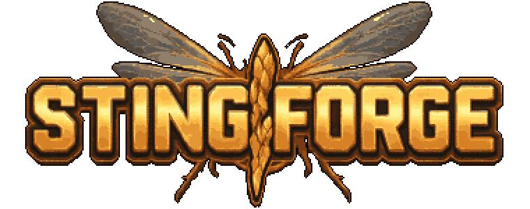
</p>

<p align="center"><b>Evolve. Adapt. Strike.</b><br>
Ein horizontales Pixel-Shoot’em-up mit einer Biene in der Hauptrolle – eine Hommage an <i>Apidya</i> (Amiga, 1992).</p>

<p align="center">
  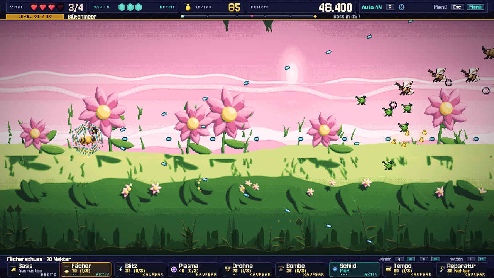
</p>

Yuri, eine Kampfbiene, fliegt durch zehn Reiche – vom sonnigen Blütenmeer über Wurzelhöhlen,
Pilzwald und Sturm bis in den biomechanischen Schwarmstock und den Kern der Verwandlung.

Waffen, Werkstatt-Upgrades und Evolutionen lassen sich zu ganz unterschiedlichen Builds kombinieren:
Wellenschuss im Kreisflug, Kettenblitz mit Splitterkern oder ein Schild als Wabenhülle.
Jedes Level endet mit einem Boss, der sich wie sein Tier bewegt und in mehreren Phasen eskaliert.

## Galerie

| | |
|---|---|
| 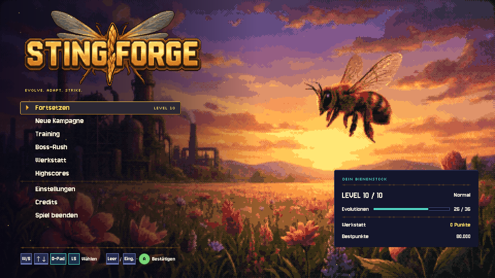 | 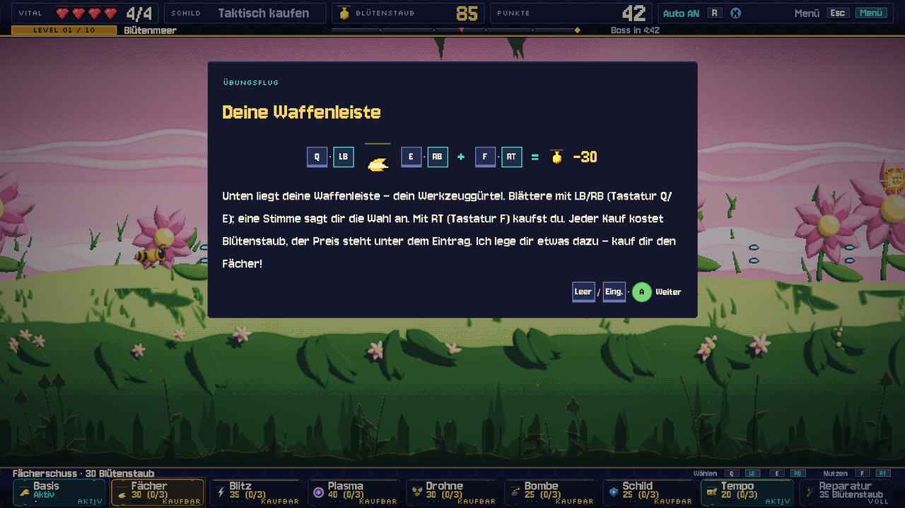 |
| **Hauptmenü** – Pixel-Titelbild, Spielstand auf einen Blick | **Tutorial** – das Spiel hält an und erklärt in Bildern |
| 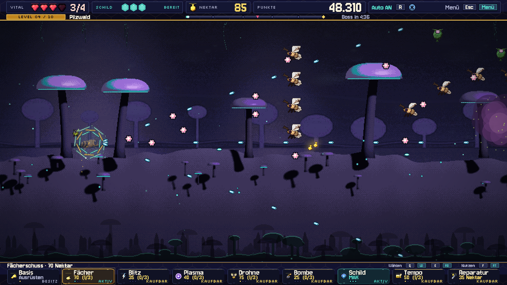 | 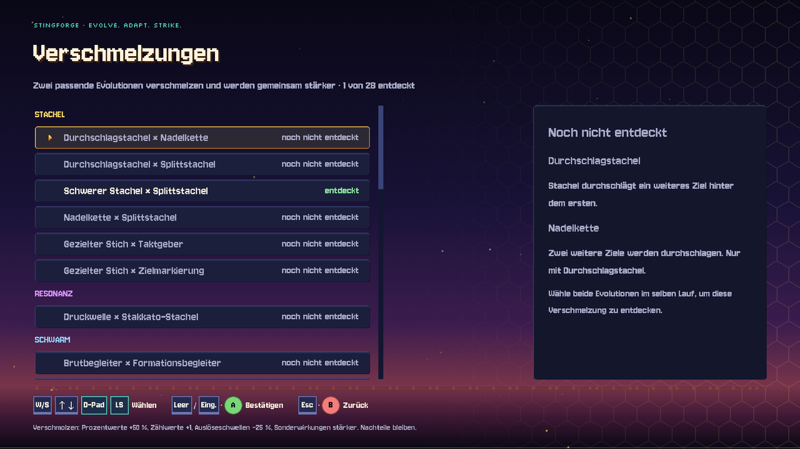 |
| **Pilzwald** – wandernde Sporenwolken engen die Wege ein | **Verschmelzungen** – entdeckte Paare, der Rest wartet ausgegraut |
| 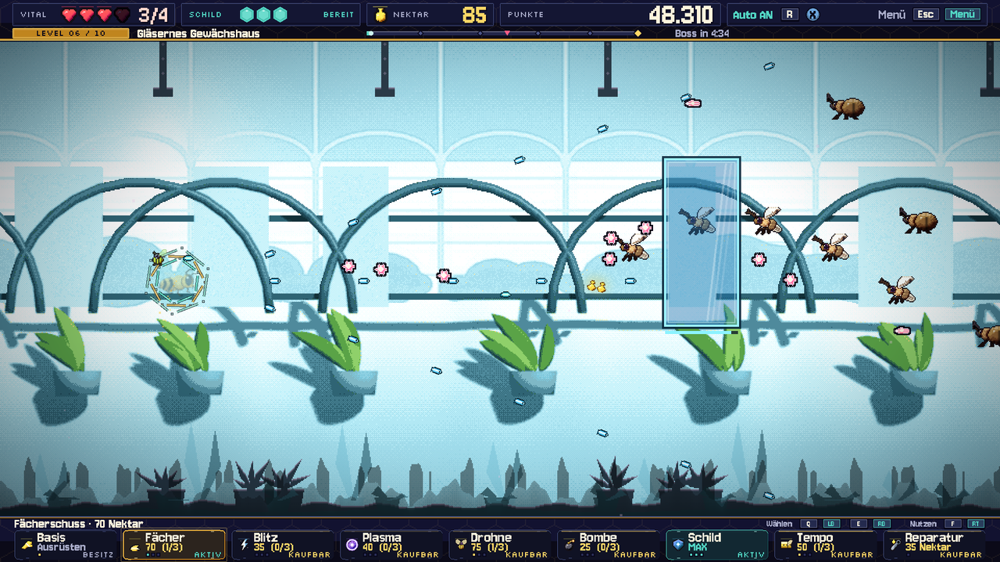 |  |
| **Gläsernes Gewächshaus** – Glasscheiben fangen Schüsse ab, bis sie zerspringen | **Grabende Riesenlarve** – Phasenwechsel mit Auftritt |
| 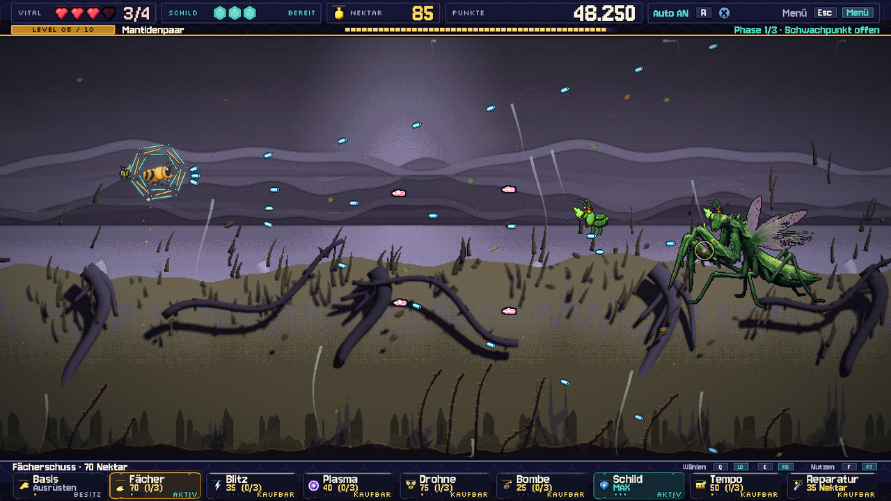 | 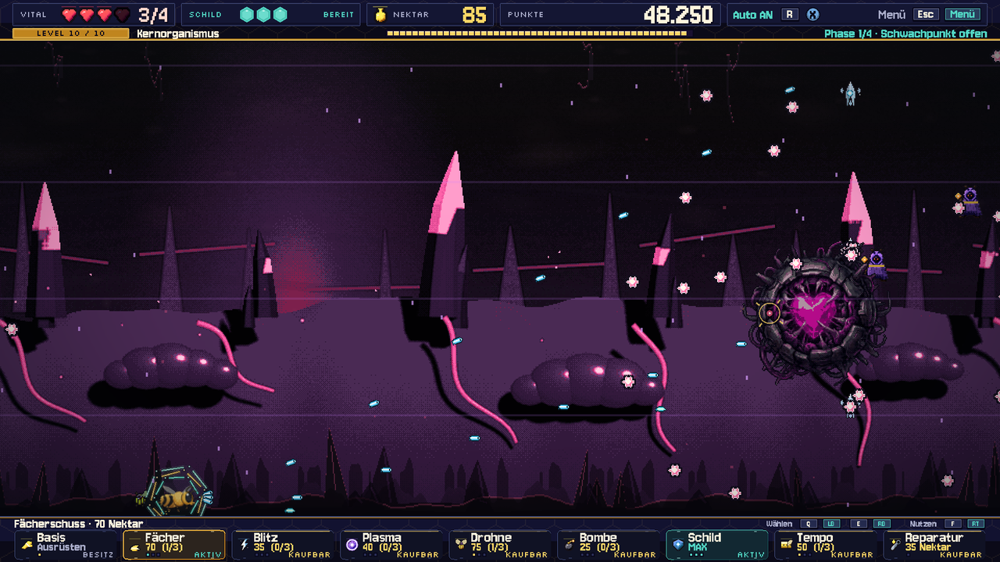 |
| **Mantidenpaar** – zwei Klingen, ein Rhythmus | **Kern der Verwandlung** – der Endboss (und nicht zum letzten Mal) |
| 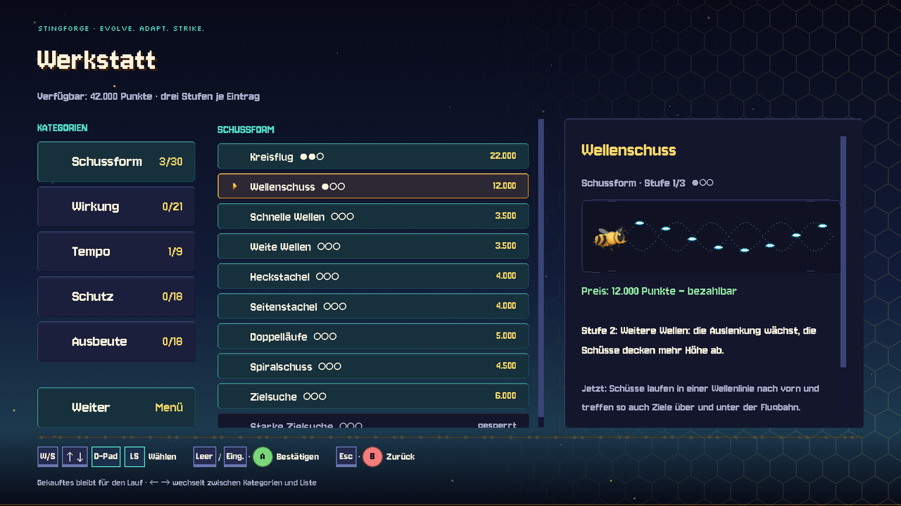 | 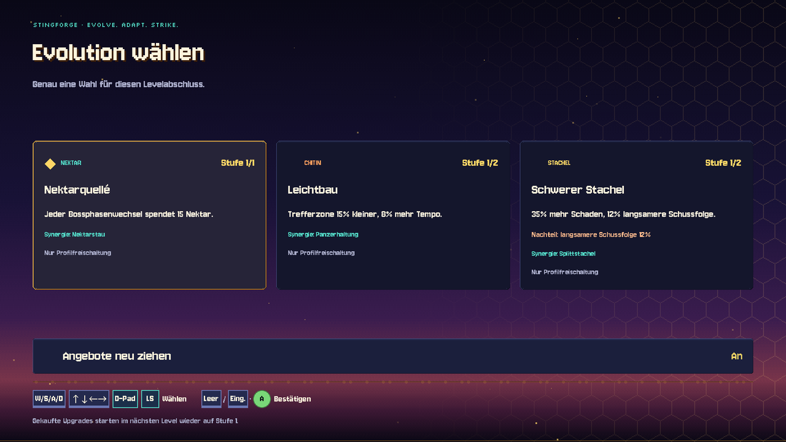 |
| **Werkstatt** – Kategorien, Upgrades, animierte Erklärszene | **Evolution** – nach jedem Level eine dauerhafte Weiterentwicklung |

**Ultrawide:** Das Spielfeld bleibt 16:9, die Seiten zeigen die Levelkulisse weiter.

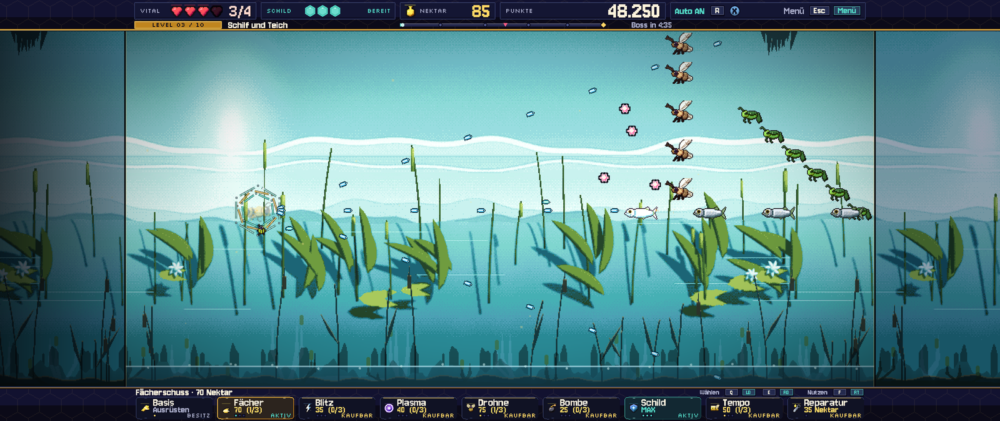
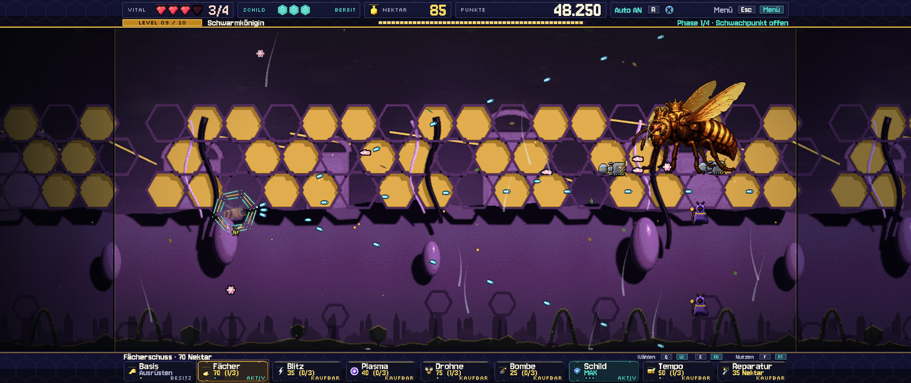

## Was drinsteckt

- **Tutorial:** ein kurzer Übungsflug in der ersten Welt erklärt Steuerung, Blütenstaub,
  Waffenleiste, Werkstatt und Highscore. Das Spiel hält dafür jeweils an und blendet ein Bildfenster ein.
- **Zehn Level, zehn Bosse:** jeder Boss mit eigenen Bewegungen und Angriffen. Phasenwechsel
  kommen mit Auftritt, und was angesagt wird, passiert auch.
- **Taktische Waffenleiste:**
  - Basis-, Fächer-, Blitz- und Plasmawaffe, Drohne, Bomben, Schild und Tempo, gekauft mit Nektar.
  - Beim Blättern sagt eine Stimme das gewählte Upgrade an.
- **Werkstatt:** 32 dauerhafte Upgrades in fünf Kategorien, mit Punkten gekauft, jedes mit einer
  animierten Erklärszene. Sie ist nur zwischen den Leveln erreichbar. Ausgegebene Punkte senken
  den Highscore.
- **Evolutionen und Starttalente:**
  - 20 Starttalente, drei davon zufällig zur Wahl; nach jedem Level eine Evolution.
  - Passende Evolutionen **verschmelzen** und werden gemeinsam stärker.
  - Entdeckte Verschmelzungen sammelt das Hauptmenü.
- **Eigener Soundtrack:**
  - Jedes Level hat einen durchkomponierten Track, exakt so lang wie der Weg bis zum Boss und
    synchron zur Levelzeit.
  - Die Bossmusik setzt nahtlos im selben Tempo ein und loopt, solange der Kampf dauert.
- **Plattformen:** Linux, Windows und macOS.
- **Pixellook in 1920 × 1080:** Ultrawide (21:9, 32:9) und 16:10, Pixelschriften, Menüs im Amiga-Stil.
- **Modi:**
  - Kampagne mit Checkpoints
  - Training
  - Boss-Rush
  - Highscores mit Namenseingabe
- **Bedienung:** Tastatur, Maus und Xbox-Controller, frei belegbar, beide Gerätearten
  immer gleichzeitig angezeigt.

## Spielen

Fertige Spieldateien für **Windows** und **Linux** werden als einzelne Datei ohne Installation
gebaut, für **macOS** (Intel und Apple Silicon) als ZIP mit der App. Sie sind zu groß für das
Repository und gehören zu den [Releases](https://github.com/floppi77/stingforge/releases).

Die Mac-App ist nicht von Apple notarisiert: beim ersten Start im Finder Rechtsklick ›
„Öffnen“ wählen.

| Aktion | Tastatur | Controller |
|---|---|---|
| Fliegen | WASD / Pfeile | linker Stick |
| Schießen (halten) | Leertaste | A |
| Waffenleiste wählen | Q / E | LB / RB |
| Kaufen / aktivieren | F | RT |
| Pause | Esc | Start |

Alles Weitere steht im [Handbuch](docs/HANDBUCH.md).

## Aus den Quellen bauen

Benötigt **Godot 4.7** (GL Compatibility).

```bash
export XDG_DATA_HOME="$PWD/.godot_data" XDG_CONFIG_HOME="$PWD/.godot_config" XDG_CACHE_HOME="$PWD/.godot_cache"
godot --headless --path . --export-release Linux build/linux/Stingforge.x86_64
godot --headless --path . --export-release Windows build/windows/Stingforge.exe
godot --headless --path . --export-release macOS build/macos/Stingforge-macOS.zip
python3 tools/verify_stingforge_r3.py     # 41 Regressionssuiten
```

Details: [Build-Anleitung](docs/BUILD.md).

## Soundtrack-Pipeline

Die Musik entsteht als Code in [tools/music](tools/music/):

1. **Komposition:** Partituren in Python mit einer Tempokarte, die jeden Checkpoint auf einen
   Taktanfang legt.
2. **Instrumente:** sfizz spielt die freien Sample-Bibliotheken ab, Csound liefert die
   Synthesizer.
3. **Mix und Mastering:** −16 LUFS, −1 dBTP.
4. **Messbericht:** je Track ein Bericht mit Spektrogramm.

Konzept und Werkzeuge: [Soundtrack-Konzept](docs/SOUNDTRACK_KONZEPT.md).
Die Sample-Bibliotheken werden nicht mitgeliefert, sondern bei Bedarf geladen.

## Projektaufbau

- **Spielwelt:** [scripts/game](scripts/game/)
- **Menüs und HUD:** [scripts/screens](scripts/screens/)
- **UI-Bausteine:** [scripts/core](scripts/core/)
- **Grafik, Schriften, Musik und Klänge:** [assets](assets/)
- **Automatisierte Prüfungen:** [tests](tests/)
- **Werkzeuge** (Pixel-Pipeline, Musik, Prüf- und Paketskripte): [tools](tools/)
- **Änderungsberichte:** [R4](docs/STINGFORGE_R4.md) · [R3](docs/STINGFORGE_R3.md) · [R2](docs/STINGFORGE_R2.md)

## Danksagung und Lizenzen Dritter

- **Schriften:** Jersey 10, Silkscreen und Nunito, alle unter der
  [SIL Open Font License](assets/ui/fonts/pixel/OFL-Jersey10.txt).
- **Samples:** [VSCO 2 Community Edition](https://github.com/sgossner/VSCO-2-CE) und
  [Versilian Community Sample Library](https://github.com/sgossner/VCSL) von Versilian Studios
  (CC0), für den Soundtrack.
- **Sprachansagen:** erzeugt lokal mit [Qwen3-TTS](https://github.com/QwenLM/Qwen3-TTS)
  (Modelle VoiceDesign und Base, Apache-2.0). Die Stimme ist aus einer Beschreibung
  entworfen, sie gehört keinem echten Sprecher.
- Made with Vibe, DeepSeek V4.1 Flash, GPT Sol 6.1, Claude Opus 5.5, Coffee and Love.
- **Vorbild:** *Apidya* (Kaiko, 1992). Stingforge ist eine eigenständige Hommage, ohne
  Verbindung zu den Rechteinhabern.

Eine Lizenz für den Projektcode ist noch nicht festgelegt.
